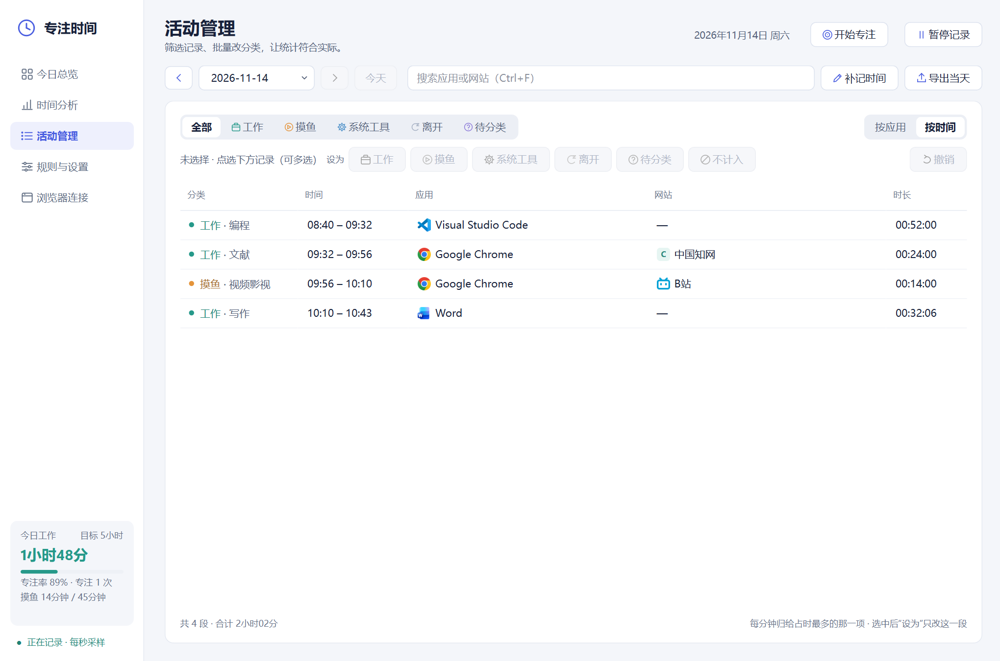
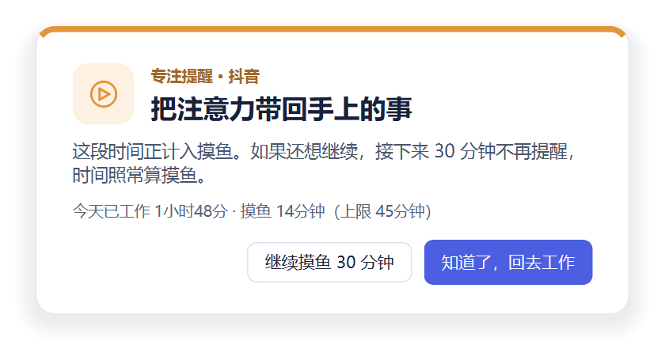
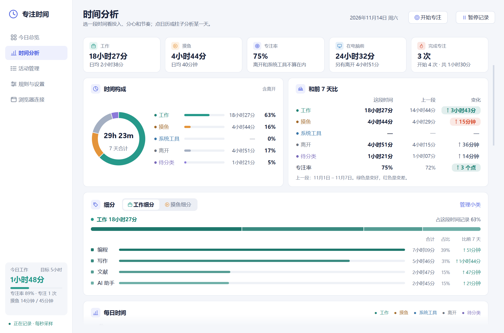
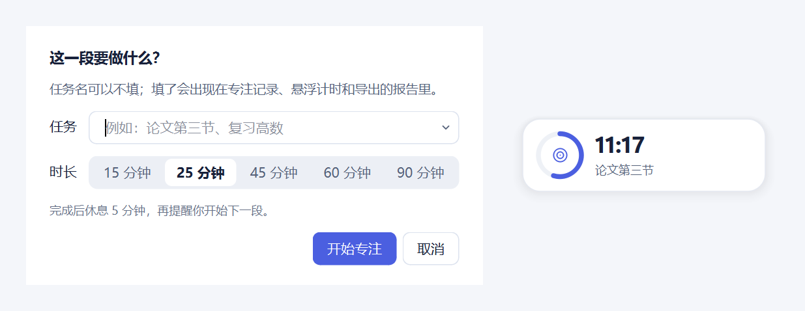

<div align="center">

# 专注时间助手

**电脑自动帮你记下：今天到底是在学习，还是在摸鱼。**

一个只在你自己电脑上运行的 Windows 小工具：每秒看一眼你正在用的窗口，把时间分成工作、摸鱼、系统工具、离开、待分类五类；刷抖音、小红书、B站太久时温柔地提醒一下；再帮你回看一天、一周是怎么过的。

[](https://github.com/Toby-Qian/focus-time-assistant/releases/latest)


[](LICENSE)

**[⬇ 下载最新版](https://github.com/Toby-Qian/focus-time-assistant/releases/latest)**　·　免费、开源、没有账号、不联网上传


</div>

## 适合谁

- 想知道自己一天真正学习 / 工作了多久的学生、研究生、自由职业者
- 一不留神就刷了一小时短视频，想有人在旁边提醒一句的人
- 不想装要登录、会上传数据的时间管理软件的人

## 能做什么

### 1. 自动记录，不用手动打卡

打开后它就在后台安静地记：**只算你正在操作的那个窗口**，后台开着的程序、桌面、最小化的窗口都不算；键盘鼠标一段时间没动、或者锁屏，就记为“离开”。

- 常用的学习、办公软件（VS Code、Word、Zotero、Claude 等）默认算**工作**，抖音、B站、小红书默认算**摸鱼**
- 任何程序、网站都能一键改成别的分类，以前记错的时间也能批量改回来，还能撤销
- 也可以按时间顺序看一天里的每一段，只改其中一段；电脑没记到的事（开会、上课、看纸质资料）能手动补记


- 网站显示成“抖音”“中国知网”“GitHub”这样的名字，网站和应用都能改成你自己习惯的叫法

### 2. 刷太久会提醒你



停留在摸鱼网站或程序时，屏幕中央会弹出提醒——不抢键盘、不锁屏。真想继续，点“继续摸鱼 30 分钟”，这段时间不再打扰，时间照样算摸鱼。还可以给单个网站设每日上限，比如“抖音每天最多 30 分钟”。

### 3. 专注日历 + 复盘


- **专注日历**：一整年一格一天，颜色越深那天工作越久，圆点表示达到了每日目标；点任意一天，整页就换成那一天的分析
- **时间构成**：工作、摸鱼、离开各占多少；可以选择占比里算不算“离开”
- **想看哪段看哪段**：今天、昨天、最近 3 / 7 / 30 天，本周、上周、本月、上月，或者自己选起止日期
- **和上一段比**：今天 vs 昨天、这 7 天 vs 前 7 天，变好是绿色，变差是红色
- **细分**：工作是在编程、写作、读文献还是用 AI，摸鱼是刷短视频、看视频、打游戏还是逛购物网站；小类可以自己改名、新建，给“短视频”这样的小类设每日上限
- **工作节奏**：最长连续工作多久、连续 25 分钟以上的深度工作有几段、每小时切换几次程序、一天几点开始几点结束
- 每日趋势、应用与网站排行、一天中的时段分布，一键导出 HTML 报告



### 4. 想专心的时候开一段专注



写上任务名、选时长就开始；桌面上有个可拖动的小悬浮计时，结束后自动休息，再提醒你开始下一段。专注记录会出现在分析页和导出的报告里。

### 5. 其他

- 关掉窗口后在托盘继续记录，托盘图标颜色跟着当前分类变；可以暂停 15 / 30 / 60 分钟
- 每日工作目标、摸鱼上限、连续达标天数、休息提醒、每日总结、离开太久回来时问一句刚才那段算工作、摸鱼还是离开
- 5 套配色（含深色），适配高分屏；支持开机自动在托盘运行
- 很省资源：收进托盘后约 0.1% CPU、十几 MB 内存

## 下载和使用

1. 打开 **[Releases 页面](https://github.com/Toby-Qian/focus-time-assistant/releases/latest)**，下载 `FocusTimeAssistant-…-win64.zip`
2. 解压到任意文件夹（比如 `D:\专注时间助手`），双击里面的 **专注时间助手.exe**
3. 开始用电脑就会自动记录；关闭窗口后它会留在右下角托盘里继续记

> 第一次打开如果出现“Windows 已保护你的电脑”，点 **更多信息 → 仍要运行**。这是因为个人开发的程序没有购买代码签名证书，不是病毒；所有代码都在这个仓库里，可以自己检查。

- 想开机自动运行：在“规则与设置”里勾选“开机启动”
- 记录保存在解压文件夹里的 `data` 文件夹；换电脑时把它一起拷走，或者在“规则与设置 → 分析与导出”里先“备份”、到新电脑上再“恢复”
- 不想用了：从托盘退出，删掉整个文件夹即可，不会在系统里留下别的东西（开过“开机启动”的话先把它关掉）

## 浏览器扩展（可选，推荐）

不装扩展时，程序按窗口标题识别抖音、小红书、B站等常见网站；装上后按真实网址的域名识别，更准确，还能显示网站图标。支持 Chrome、Edge 等 Chromium 内核浏览器。

1. 打开程序，进入侧栏“浏览器连接”，复制本机连接码
2. Chrome 打开 `chrome://extensions`（Edge 打开 `edge://extensions`），开启“开发者模式”
3. 点“加载已解压的扩展程序”，选择程序文件夹里的 `browser_extension` 文件夹
4. 在弹出的设置页粘贴连接码并保存

扩展只把当前标签页的域名、用于核对的标题和浏览器已缓存的网站图标发给本机上的这个程序（`127.0.0.1`），需要连接码才能通信，不连接任何外部服务器。

## 隐私

- 所有数据只存在你自己的电脑上，没有账号，不联网上传
- 只记录：日期和分钟、分类、程序文件名、网站域名、累计时长
- **不保存**网址路径、搜索词、页面标题、截图、聊天内容或按键
- 想清空历史：退出程序后删掉 `data` 文件夹里的 `activity.sqlite3`

## 常见问题

**会不会很耗电、拖慢电脑？**
不会。它每秒只读一次前台窗口的名字，收进托盘后大约占 0.1% 的 CPU 和十几 MB 内存。

**看视频、读纸质书的时候会被算成“离开”吗？**
键盘鼠标长时间不动会算离开。可以在设置里把“无操作多久算离开”调长；离开太久回来时，它会问你刚才那段算工作、摸鱼还是离开（比如看网课、开会、看书）。事后想起来，也能在“活动管理”里点“补记时间”补上。

**我的某个软件被分错类了怎么办？**
在“今日总览”点“调整分类”，或在“活动管理”里右键那一行，选成你想要的分类，以后都会按新规则记录。只想改某一段时间（比如那半小时的微信其实是在谈工作），切到“按时间”，选中那一段再改。

**支持 Mac 吗？**
暂时只支持 Windows 10 / 11。

## 从源码运行

需要 Windows 10 / 11 和 Python 3.12。

```powershell
python -m venv .venv
.\.venv\Scripts\python.exe -m pip install -r requirements.txt
.\.venv\Scripts\python.exe app\main.py
```

之后也可以双击 `启动.cmd` 启动（不会出现命令行窗口）。打包成 EXE：

```powershell
.\.venv\Scripts\python.exe -m pip install pyinstaller
.\.venv\Scripts\python.exe build_exe.py
```

源码在 `app/`：`windows.py` 读取前台窗口和空闲时间，`core.py` 负责分类与 SQLite 记录，`desktop.py` 是采样和界面逻辑，`ui_qt.py` / `charts.py` / `theme.py` 是 Qt 界面、图表和主题，`insights.py` 生成分析要点，`bridge.py` 是给浏览器扩展用的本机接口。测试：

```powershell
.\.venv\Scripts\python.exe -m unittest discover -s tests
.\.venv\Scripts\python.exe tests\check_qt_desktop.py     # 完整界面检查，约 1–2 分钟，会短暂显示窗口
```

这是一个对行为的估计工具：它只能看到你在用哪个窗口，不能判断你是否真的在专注，分类可以随时手动修正。欢迎提 Issue 和建议。

## 版本记录

见 [CHANGELOG.md](CHANGELOG.md)。当前版本 1.2（2026-11-14）。

## 许可证

[MIT](LICENSE)
