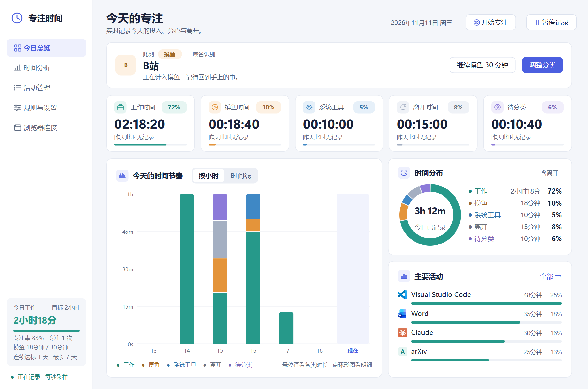
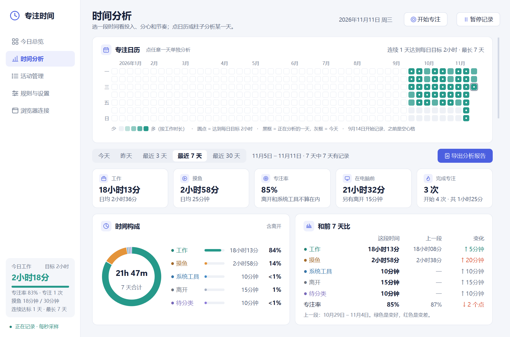

# 专注时间助手

一个只在你自己电脑上运行的 Windows 计时工具：每秒看一眼你正在用的窗口，把时间分成**工作、摸鱼、系统工具、离开、待分类**，在你刷抖音、小红书、B站时温和地提醒一下，并帮你回看一天、一周是怎么过的。



所有数据都留在本机，没有账号，不联网上传；不保存网址路径、页面标题、截图或按键。

## 功能

- **只计你正在操作的窗口**：后台程序、桌面、任务栏、最小化的窗口都不计时（需要时也可以给它们设规则）。键盘鼠标一段时间没动或锁屏就记为离开。
- **今日总览**：此刻在用什么、五类时间、每小时节奏或分钟时间线、时间分布环形图、主要活动（带程序和网站图标）；占比可以切换含 / 不含离开时间（设置里或环形图右上角）。
- **分类规则**：内置常用工作软件和摸鱼网站；任何程序、网站、系统界面都能改成任一分类；规则表可按分类筛选、单击改分类、设置单个程序 / 网站的每日上限。
- **活动管理**：按日期、分类、关键字查看记录，批量改分类，可撤销；离开时间也能补记成工作（开会、看纸质资料）。
- **显示名字可改**：常见网站显示为“抖音”“GitHub”等名字而不是域名；网站和应用都可以右键改成自己习惯的名字。
- **摸鱼提醒**：停留在摸鱼网站或程序时在屏幕中央提醒，不抢键盘焦点；想继续可以点“继续摸鱼 30 分钟”，这段时间不再提醒，照常算摸鱼。
- **专注**：写上任务名、选时长开始专注，有可拖动的悬浮计时，结束后自动休息，再提醒开始下一段。
- **目标与习惯**：每日工作目标、摸鱼上限、连续达标天数、专注日历、休息提醒、每日总结（默认关闭）、回来时补记（离开太久回来时问一次）。
- **时间分析**：今天 / 昨天 / 最近 3、7、30 天，或在专注日历上点任意一天单独分析；时间构成饼图、每日趋势、应用与网站排行、时段分布、工作节奏（最长连续工作、深度工作、切换频率、作息）、和上一段时间的对比，以及自动生成的要点；可导出 HTML 报告。
- **托盘常驻**：关窗后在托盘继续记录，托盘图标颜色跟随当前分类；可定时暂停（15 / 30 / 60 分钟）。
- **低占用**：收进托盘时约 0.1% 单核 CPU、约 10 MB 工作集；数据库每 10 秒批量写入。
- 5 套主题（含深色），适配高分屏和多显示器缩放；支持键盘操作，尊重 Windows 的“动画效果”设置。



## 运行

需要 Windows 10 / 11 和 Python 3.12。

```powershell
python -m venv .venv
.\.venv\Scripts\python.exe -m pip install -r requirements.txt
.\.venv\Scripts\python.exe app\main.py
```

之后也可以双击 `启动.cmd` 启动（不会出现命令行窗口）。记录、规则和设置保存在项目里的 `data/` 文件夹。

打包成不需要 Python 的 EXE：

```powershell
.\.venv\Scripts\python.exe -m pip install pyinstaller
.\.venv\Scripts\python.exe build_exe.py
```

生成的程序在 `程序/专注时间助手.exe`，和源码共用同一个 `data/`。

## 浏览器扩展（可选，推荐）

不装扩展时，程序按窗口标题识别抖音、小红书、B站等常见网站；装上后按真实域名识别，更准确，还能显示网站图标。

1. 打开程序，进入侧栏“浏览器连接”，复制本机连接码。
2. Chrome 打开 `chrome://extensions`（Edge 打开 `edge://extensions`），开启“开发者模式”。
3. 点“加载已解压的扩展程序”，选择本项目的 `browser_extension` 文件夹。
4. 在弹出的设置页粘贴连接码并保存。

扩展只把当前活动标签页的域名、用于核对的标题和浏览器已缓存的网站图标发给 `127.0.0.1` 上的本程序，需要连接码才能通信，不连接任何外部服务器。支持 Chrome、Edge 等 Chromium 内核浏览器（Manifest V3），Firefox 暂不支持。

## 数据与隐私

- 数据库只记录：日期和分钟、分类、程序文件名、网站域名、累计秒数，以及撤销修正所需的信息。
- 不保存网址路径、搜索词、页面标题、截图、正文或按键。
- 程序和网站图标缓存在 `data/` 里，只在本机使用。
- 设置里可以一键备份数据库；想清空历史，退出程序后移走 `data/activity.sqlite3` 即可。
- `data/` 里有扩展连接码，请不要把它上传或分享。

## 开发

```powershell
.\.venv\Scripts\python.exe -m unittest discover -s tests
.\.venv\Scripts\python.exe tests\check_qt_desktop.py     # 完整界面检查，约 1–2 分钟，会短暂显示窗口
```

源码在 `app/`：`windows.py` 读取前台窗口和空闲时间，`core.py` 负责分类与 SQLite 记录，`desktop.py` 是采样和界面逻辑，`ui_qt.py` / `charts.py` / `theme.py` 是 Qt 界面、图表和主题，`bridge.py` 是给浏览器扩展用的本机接口。

这是一个对行为的估计工具：它只能看到你在用哪个窗口，不能判断你是否真的在专注，分类可以随时手动修正。

## 许可证

[MIT](LICENSE)
